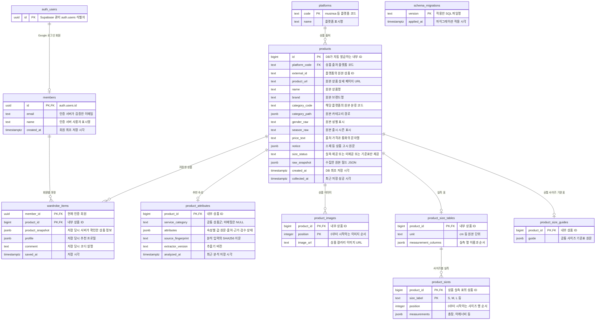

# 상품 수집 DB ERD

여러 플랫폼의 상품을 저장하는 PostgreSQL 구조입니다. 현재 수집기는 무신사만 구현되어 있습니다.

- `products.id`는 플랫폼과 무관한 내부 ID입니다. 이미지·실측은 이 ID를 참조합니다.
- `(platform_code, external_id)`에 복합 유일키가 있습니다. 예를 들어 `musinsa / 123`과 `other-shop / 123`은 서로 다른 상품입니다.
- `external_id`는 문자열이므로 숫자뿐 아니라 `SKU-A-001` 형태도 보존합니다. 같은 조합을 재수집하면 기존 내부 ID로 갱신합니다.
- 원본 카테고리 코드도 플랫폼 범위에서 해석합니다. 다른 플랫폼의 동일 코드가 같은 분류를 의미하지 않습니다.
- 플랫폼은 등록된 상품이 있으면 삭제할 수 없습니다. 상품 이하의 이미지·실측 외래키는 `ON DELETE CASCADE`입니다.
- 상품별 실측 표는 최대 1개이며, 명시적으로 미제공인 상품에는 없습니다.
- `product_images`의 `(product_id, position)`은 복합 기본키이며 `(product_id, image_url)`도 유일합니다.
- `product_sizes`의 `(product_id, size_label)`은 복합 기본키이며 `(product_id, position)`도 유일합니다.
- 상품·이미지·실측 갱신은 하나의 트랜잭션에서 수행합니다.
- `schema_migrations`는 다른 테이블과 관계가 없는 마이그레이션 관리 테이블입니다.
- `price_text`는 JSON-LD 가격 원문이며 쿠폰 적용 최종 결제 가격을 의미하지 않습니다.

## 컬럼 설명

`NULL 가능`은 현재 DB 제약 기준입니다. `불가`인 JSONB 컬럼도 빈 객체 `{}` 또는 빈 배열 `[]`을 저장할 수 있습니다.
예시는 값의 형태를 설명하기 위한 것으로 실제 상품 정보를 보장하지 않습니다.

### platforms — 수집 출처

| 컬럼 | 타입 | NULL 가능 | 의미와 저장 기준 | 예시 |
|---|---|---|---|---|
| `code` | TEXT | 불가 | 플랫폼 식별 코드. 영문 소문자로 시작하고 소문자·숫자·밑줄·하이픈을 사용합니다. | `musinsa` |
| `name` | TEXT | 불가 | 플랫폼의 사람이 읽는 표시명. 상품명이 아닙니다. | `무신사` |

### products — 플랫폼별 상품

| 컬럼 | 타입 | NULL 가능 | 의미와 저장 기준 | 예시 |
|---|---|---|---|---|
| `id` | BIGINT | 불가 | DB가 자동 발급하는 내부 상품 ID. 이미지·실측을 연결하며 외부 상품 ID와 구분합니다. | `1` |
| `platform_code` | TEXT | 불가 | 상품을 수집한 플랫폼. `platforms.code`를 참조합니다. | `musinsa` |
| `external_id` | TEXT | 불가 | 해당 플랫폼의 원본 상품 식별자. 앞자리 0이나 문자도 보존하는 문자열입니다. | `7428042`, `SKU-A-001` |
| `product_url` | TEXT | 불가 | 원본 상품 상세 페이지 URL. 식별 키가 아니며 재수집 시 갱신할 수 있습니다. | `https://www.musinsa.com/products/7428042` |
| `name` | TEXT | 불가 | 플랫폼에 표시된 상품명. 브랜드명이나 플랫폼명과 별도로 저장합니다. 빈 문자열은 허용하지 않습니다. | `LABEL INCISION LONG SLEEVE T-SHIRT, PURPLE` |
| `brand` | TEXT | 가능 | 플랫폼이 제공한 브랜드 표시명. 별도 브랜드 ID나 여러 플랫폼 간 통합 브랜드 식별자가 아닙니다. | `런던다다` |
| `category_code` | TEXT | 가능 | 원본 카테고리 경로의 마지막 분류 코드. 반드시 플랫폼과 함께 해석합니다. | `001010` |
| `category_path` | JSONB | 불가 | 상위부터 하위까지 원본 카테고리의 코드·이름 목록. 무신사 수집기는 상품의 분류 경로만 읽고 브랜드 필터·추천 링크를 제외하며, 빈 경로나 잘못된 계층은 저장하지 않습니다. DB 자체는 빈 배열도 허용합니다. | `[{"code":"001","name":"상의"},{"code":"001010","name":"긴소매 티셔츠"}]` |
| `gender_raw` | TEXT | 가능 | 플랫폼에 표시된 성별 원문. 서비스 공통 코드로 변환하지 않은 값입니다. | `여`, `공용` |
| `season_raw` | TEXT | 가능 | 플랫폼에 표시된 출시 시즌 원문. 권장 착용 계절을 뜻하지 않습니다. | `2025 FW`, `ALL ALL` |
| `price_text` | TEXT | 가능 | 출처가 제공한 가격·통화를 문자열로 보존합니다. 현재 무신사 수집기는 JSON-LD `offers`에서 읽으며, 쿠폰 적용가나 최종 결제 금액을 보장하지 않습니다. 출처는 `raw_snapshot.price_source`에 있습니다. | `75910 KRW` |
| `notice` | JSONB | 불가 | 상품 고시 항목명과 값의 원문 객체. 소재·색상 등이 포함되며 ‘상세설명 참조’도 그대로 보존합니다. 미수집 시 빈 객체입니다. | `{"제품 소재":"Cotton 100%","색상":"상품 상세설명 참조"}` |
| `size_status` | TEXT | 불가 | 실측 표 상태. `available`은 정상 추출, `not_provided`는 명시적 미제공 안내, `standard_guide_only`는 실측 없이 공통 기준표만 확인한 경우입니다. 로딩 실패는 이 값으로 저장하지 않습니다. | `available` |
| `raw_snapshot` | JSONB | 불가 | 재검증을 위해 추출한 원본 필드 묶음. 사이즈 목록·표 행·이미지 URL·고시·구조화 데이터 등을 포함하며 전체 HTML 사본은 아닙니다. | `{"product_url":"...","size_table":{"labels":["cm","내 사이즈","S"],"headers":["1총장"],"rows":[["사이즈를 직접 입력해주세요"],["60"]]}}` |
| `created_at` | TIMESTAMPTZ | 불가 | DB에 처음 저장한 시각. 재수집해도 유지합니다. | `2026-10-30T12:00:00+00:00` |
| `collected_at` | TIMESTAMPTZ | 불가 | 가장 최근 수집 결과를 성공적으로 저장한 시각. 재수집 성공 시 갱신하며 실패 시 기존 값을 유지합니다. | `2026-10-30T12:10:00+00:00` |

### product_images — 상품 갤러리 이미지

| 컬럼 | 타입 | NULL 가능 | 의미와 저장 기준 | 예시 |
|---|---|---|---|---|
| `product_id` | BIGINT | 불가 | `products.id`를 참조하는 내부 상품 ID입니다. | `1` |
| `position` | INTEGER | 불가 | 수집된 갤러리 이미지 순서. 0부터 시작하며 같은 상품에서 중복되지 않습니다. | `0`, `1` |
| `image_url` | TEXT | 불가 | 해당 상품의 갤러리 이미지 URL. 이미지 파일 자체는 저장하지 않습니다. | `https://image.msscdn.net/.../front.jpg?w=1200` |

### product_size_tables — 상품 실측 표 정보

| 컬럼 | 타입 | NULL 가능 | 의미와 저장 기준 | 예시 |
|---|---|---|---|---|
| `product_id` | BIGINT | 불가 | `products.id`를 참조합니다. 상품당 최대 한 행만 존재합니다. | `1` |
| `unit` | TEXT | 불가 | 원본 실측 표에 표시된 측정 단위입니다. 단위를 임의 변환하지 않습니다. | `cm` |
| `measurement_columns` | JSONB | 불가 | 실측 항목명을 원본 열 순서로 저장한 배열. 현재 수집기는 `1총장`처럼 항목 앞의 순번을 제거합니다. | `["총장","어깨너비","가슴단면"]` |

### product_sizes — 사이즈별 실측값

| 컬럼 | 타입 | NULL 가능 | 의미와 저장 기준 | 예시 |
|---|---|---|---|---|
| `product_id` | BIGINT | 불가 | `product_size_tables.product_id`를 참조합니다. 원본 외부 상품 ID가 아닙니다. | `1` |
| `size_label` | TEXT | 불가 | 실측 표에 나온 사이즈명. 현재 구매 가능한 재고 옵션을 뜻하지 않으며 ‘내 사이즈’ 비교 행은 제외합니다. | `S`, `M`, `FREE` |
| `position` | INTEGER | 불가 | 원본 표에서의 사이즈 행 순서. 0부터 시작합니다. | `0`, `1` |
| `measurements` | JSONB | 불가 | 항목명과 측정값 객체. 숫자는 수치, `-`와 빈 값은 JSON null, `40~42` 같은 범위 표현은 문자열로 저장합니다. 표시 순서는 `measurement_columns`를 사용합니다. | `{"총장":60,"어깨너비":40.5,"밑단단면":null}` |

### product_size_guides — 공통 사이즈 기준표

| 컬럼 | 타입 | NULL 가능 | 의미와 저장 기준 | 예시 |
|---|---|---|---|---|
| `product_id` | BIGINT | 불가 | `products.id`를 참조합니다. 상품당 최대 1행입니다. | `1` |
| `guide` | JSONB | 불가 | 기준표의 행 제목(`row_labels`), 셀 배열(`rows`), 설명(`description`)을 원문으로 보존합니다. 상품 실측이나 판매 가능 옵션이 아닙니다. 국가·성별별 묶음 제목과 행 개수는 다를 수 있습니다. | `{"row_labels":["한국(mm)","일본(cm)"],"rows":[["220","225"],["22","22.5"]],"description":"사이즈 참고표"}` |

### schema_migrations — 스키마 적용 이력

| 컬럼 | 타입 | NULL 가능 | 의미와 저장 기준 | 예시 |
|---|---|---|---|---|
| `version` | TEXT | 불가 | 적용한 SQL 파일명. 같은 파일을 중복 적용하지 않기 위한 키입니다. | `002_platform_identity.sql` |
| `applied_at` | TIMESTAMPTZ | 불가 | 해당 마이그레이션 적용 시 DB가 기록한 시각입니다. | `2026-10-30T12:00:00+00:00` |

## 마이그레이션

- [001_initial.sql](../tools/scraping/src/catalog_scraper/migrations/001_initial.sql): 최초 무신사 단일 출처 구조.
- [002_platform_identity.sql](../tools/scraping/src/catalog_scraper/migrations/002_platform_identity.sql): 플랫폼과 외부 ID 분리 및 내부 ID 자동 발급.

- [003_standard_size_guides.sql](../tools/scraping/src/catalog_scraper/migrations/003_standard_size_guides.sql): 공통 기준표 별도 저장 및 상태 구분.

기존 데이터의 내부 ID·이미지·실측 참조는 변경하지 않고 원래 ID를 `external_id`에 복사합니다.
이전 ID와 외부 ID가 우연히 같더라도 앞으로 두 필드를 동일하다고 가정하면 안 됩니다.
`schema_migrations`는 [storage.py](../tools/scraping/src/catalog_scraper/storage.py)의 초기화 코드에서 생성합니다.

## 추천 속성: product_attributes

마이그레이션 `004_product_attributes.sql`로 추가했다. 원문 테이블과 1:0..1 관계이며 상품 삭제 시 함께 삭제된다. `service_category`는 TOP/BOTTOM/SHOES/BAG/OUTER로 플랫폼 분류와 분리한다.

`attributes`의 각 키는 `value`(표준값 또는 null), `raw_value`(원문), `source`(product_name/notice/category_path/product_info), `evidence`(일치한 문구), `review_status`를 가진다. 자동 추출은 pending, 승인은 approved, 거절은 rejected다. 검수 대기는 추천 점수에 사용할 수 있지만 필수 조건 충족의 증거는 아니다.

`source_fingerprint`와 `extractor_version`이 현재 원문·추출기와 일치할 때만 추천에 사용한다. 수집 시각만 달라진 원문은 재분석하지 않는다. JSONB는 객체 여부를 DB에서 확인하고 세부 계약은 Pydantic에서 검증한다.

무신사의 `핏/계절감` 표에서 선택된 핏은 `products.raw_snapshot.material_info.핏`에 배열로 보관한다. 추천 속성은 선택값을 상품명보다 우선하고 복수 선택이면 오버사이즈 > 루즈 > 레귤러 > 슬림 순으로 하나를 정규화한다. `product_info` 출처와 전체 선택 원문을 유지하며 이 원문도 분석 지문에 포함한다.

## 회원·옷장 컬럼과 접근

그림의 `auth_users`는 Supabase 관리 테이블 `auth.users`입니다. 앱이 인증 스키마를 직접 생성하거나 비밀번호를 저장하지 않습니다.

| 테이블·컬럼 | 의미·제약 |
|---|---|
| `members.id` | UUID 기본키, `auth.users.id` 참조. Auth 사용자 삭제 시 회원도 삭제 |
| `members.email`, `name` | 인증 서버에서 확인한 이메일·표시명. NOT NULL |
| `members.created_at` | 최초 회원 생성 시각, 기본 now() |
| `wardrobe_items.member_id` | `members.id` 참조. 상품 ID와 복합 기본키 |
| `wardrobe_items.product_id` | `products.id` 참조. 상품 삭제 시 해당 저장 항목도 삭제 |
| `wardrobe_items.product_snapshot` | 서버가 확인한 저장 당시 상품 JSON 객체. 클라이언트 가격을 신뢰하지 않음 |
| `wardrobe_items.profile` | 저장 당시 체형·성별·TPO·추구미·태그 JSON 객체 |
| `wardrobe_items.comment` | 최대 1,000자, 기본 빈 문자열 |
| `wardrobe_items.saved_at` | 저장 시각, 기본 now() |

회원·옷장 컬럼은 모두 NOT NULL입니다. 동일 상품을 서로 다른 회원이 각각 저장할 수 있고, 같은 회원은 같은 상품을 한 항목으로 갱신합니다. 회원 삭제 시 옷장도 삭제됩니다.

두 앱 테이블은 RLS를 활성화하고 authenticated에는 본인 SELECT 정책만 제공합니다. 앱의 쓰기는 FastAPI가 검증한 회원 ID로 DB에 수행합니다. 카탈로그 테이블은 anon/authenticated 직접 접근을 허용하지 않습니다. 공개 Supabase 키만으로 임의 회원 옷장이나 상품 테이블을 조회하도록 설계하지 않았습니다.

## 저장 위치와 이관 확인

2026-11-01 확인 기준 로컬 Supabase `127.0.0.1:54322/postgres`에 상품 1,024개가 있고 Docker 볼륨은 `supabase_db_hackathon`입니다. 이전 독립 PostgreSQL `55432/hackathon`의 671개는 별도 볼륨에 남아 있습니다.

원격에는 상품 1,024개, 이미지 URL 6,876개, 실측 표 829개, 사이즈 행 2,362개, 공통 기준표 159개, 정제 속성 1,024개를 복사하고 체크섬을 비교했습니다. 당시 기존 회원 1명·Auth 계정 1개를 보존했습니다. 이 수치는 해당 이관 시점의 검증 결과이며 현재 운영 중인 회원 수를 고정한다는 뜻이 아닙니다.

상품군은 TOP 331 / BOTTOM 176 / OUTER 178 / SHOES 162 / BAG 177입니다. 상품 중복과 이미지 누락이 없고 추천 코드에서 1,024개 정제 속성이 최신으로 로드되는 것을 확인했습니다. [이관 스크립트](../tools/database/migrate_catalog.py)는 비어 있는 대상 카탈로그에만 적용합니다.
